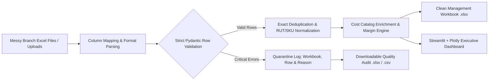

# From Spreadsheet Chaos to Automated Executive Visibility

[](https://github.com/longaresf/excel-chaos-to-dashboard-demo/actions/workflows/ci.yml)


## Business Impact & Operational Use Case

Mid-sized companies frequently lose **8 to 15 hours per week** manually merging branch Excel files exported from ERPs or local point-of-sale systems. Inconsistent date formats, malformed tax IDs (RUTs), duplicate rows, and broken formulas lead to delayed management reports and unreliable gross margin calculations.

This runnable B2B demo shows operations and finance leaders how **automated schema validation and deterministic data pipelines** replace manual spreadsheet cleanup with a single, auditable source of truth—without replacing their existing ERP.

### Key Outcomes
* **Zero Silent Data Loss:** Invalid records are quarantined with exact workbook, row number, and failure reason rather than silently dropped or distorting KPIs.
* **Standardized Master Data:** Automatically normalizes tax IDs, mixed date formats, currency strings, and product SKUs before joining cost catalogs.
* **Audit-Ready Outputs:** Delivers both an executive web dashboard and clean, ready-to-use `.xlsx` management workbooks.

---

## Data Flow Architecture


---
## The 3-Minute Live Walkthrough

1. The Problem (Raw Inputs): Inspect the original branch workbooks in data/dirty_input/ and spot real-world data issues—inconsistent date strings, mixed currency symbols, unformatted tax IDs, missing values, and duplicate rows.

2. The Quality Audit (Automated Controls): Run the pipeline to review processed vs. quarantined row counts, inspect exact anomaly reasons, and export the quality audit log as CSV or Excel.

3. Executive Visibility (Clean Output): Explore net sales and gross margin across branches, months, and products in the interactive Plotly dashboard, and download the consolidated management workbook.

Interactive Uploads: Use the sidebar to rerun the sample files or upload custom .xlsx sales sheets and cost catalogs (SKU + Costo Unitario).

## Quick Start

Option 1: Docker Compose (Recommended)

```bash
docker compose up --build
```

Open `http://localhost:8501`. The container automatically generates the three sample Excel workbooks if missing, executes the initial cleaning pipeline, and launches the dashboard. All inputs and outputs persist under `data/`.

Option 2: Local Python (3.11+)

```bash
python -m venv .venv
# Windows:
.venv\Scripts\activate
# macOS/Linux:
source .venv/bin/activate
python -m pip install -r requirements.txt
python -m src.generate_messy_excels
python -m src.cleaner_pipeline
streamlit run app/dashboard.py
```

Run the automated test suite:

```bash
pytest -q
```

Project Layout & Outputs

├── .github/workflows/ci.yml       # Automated CI checks on pushes and PRs
├── data/
│   ├── dirty_input/               # Generated messy branch Excel workbooks
│   └── clean_output/              # Consolidated report and quality audit outputs
├── src/
│   ├── generate_messy_excels.py   # Deterministic messy Excel data generator
│   ├── cleaner_pipeline.py        # Parsing, Pydantic validation, cleaning & audit logs
│   └── kpi_engine.py              # Branch, seller, monthly, and product margin metrics
├── app/
│   └── dashboard.py               # Three-view Streamlit and Plotly application
└── tests/
    └── test_cleaner.py            # Unit and regression tests

## Generated Artifacts

- `data/clean_output/reporte_gerencial_limpio.xlsx` — Validated transactions and aggregated KPI worksheets.
- `data/clean_output/auditoria_calidad.xlsx`— Granular anomaly log (exact duplicates, normalized IDs, negative-margin alerts, and quarantined rows).
- The dashboard also offers a CSV download of the anomaly list.


✒️ Author: Francisco Longares — Data Scientist & AI Solutions Developer — longaresf
